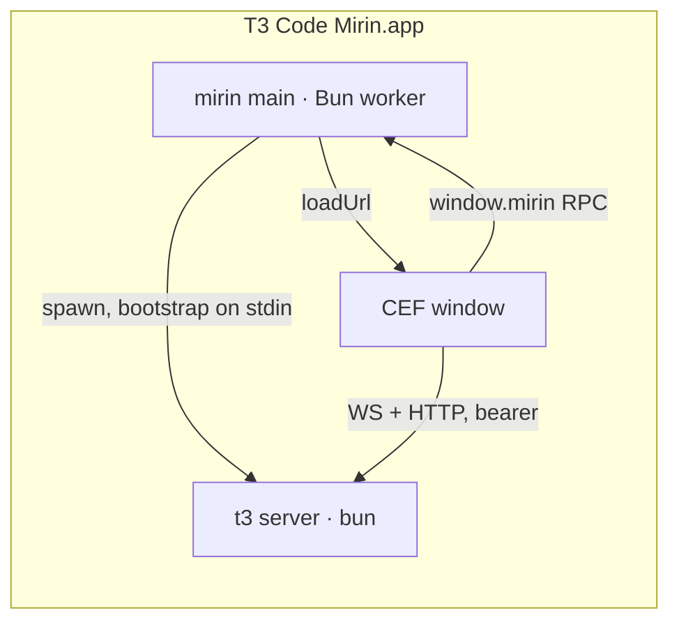

# T3 Code on mirin

This fork replaces the Electron shell (`apps/desktop`) with a [mirin](https://github.com/Netko-Labs/mirin)
app (`apps/desktop-mirin`): a Bun main process and a CEF window driven by a Rust core. Everything
else — the server, the web app, the shared packages — is upstream code. This document records the
decisions behind the port; `apps/desktop-mirin/README.md` is the how-to.

## Shape

- The window opens on a bundled splash, then loads the UI **from the server** (`http://127.0.0.1:<port>`),
  exactly like the browser mode `npx t3` offers. There is no custom asset scheme to maintain.
- The renderer's synchronous facts (branding, environment bootstraps, locale, platform) travel in a
  `?mirinBoot=` query parameter on that first navigation and are stripped before the router runs.
- `apps/web/src/desktop/mirin` installs `window.desktopBridge` before `env.ts` samples it, so the
  web app runs in desktop mode unchanged. The bridge is typed by `MirinShellRpc` in
  `packages/contracts`; the web build never imports `mirinjs` (Bun's ambient types would leak into
  the browser typecheck).

## Decisions

| Decision                                                 | Why                                                                                                                                                                                                                                                                                |
| -------------------------------------------------------- | ---------------------------------------------------------------------------------------------------------------------------------------------------------------------------------------------------------------------------------------------------------------------------------- |
| Server runs on Bun, not a bundled Node                   | Only `node:sea` and node-pty were Node-only; `Bun.Terminal` replaces the pty, `process.getBuiltinModule` guards `node:sea`. One runtime for shell and server.                                                                                                                      |
| `@effect/platform-node` stays                            | It runs on Bun as-is. `platform-bun` is a drop-in when WebSocket throughput matters.                                                                                                                                                                                               |
| Preview tabs use the server-hosted browser               | Native in-window tabs need multi-webview support in mirin (child CEF browsers with partitions, guest preloads, a CDP bridge). The server path already streams a headless Chromium to the panel and the agent `preview_*` tools work through it. Revisit when mirin ships webviews. |
| `?mirinBoot=` instead of a preload bridge                | mirin has no per-window boot data yet; the parameter is loopback-only and the bootstrap token rotates every 12 h. Replace with mirin `bootData` when it lands.                                                                                                                     |
| Own URL scheme `t3code-mirin://`                         | The official app owns `t3code://`; the shell normalizes incoming links to `t3code://` so the web app's link parsing is untouched.                                                                                                                                                  |
| CLI command is `t3-mirin`                                | Never shadows or is shadowed by the official `t3` on PATH.                                                                                                                                                                                                                         |
| Port base 3873, `T3CODE_HOME=~/.t3-mirin`, telemetry off | The fork must coexist with an installed T3 Code (3773, `~/.t3`). A loopback-only bind succeeds beside a wildcard listener, so the port probe checks `127.0.0.1`, `0.0.0.0` and `::`.                                                                                               |
| Context menus resolve on the next interaction            | mirin cannot report a dismissed native popup; the renderer settles the promise on its next pointer/key event.                                                                                                                                                                      |
| Secrets                                                  | The shell stores client settings as JSON under `T3CODE_HOME`; bearer tokens live in memory. The Electron `safeStorage` blobs are not migrated.                                                                                                                                     |
| Codex / ChatGPT sign-in                                  | The shared loopback receiver runs in the shell process, as in Electron.                                                                                                                                                                                                            |

## Not ported (yet)

- SnapShots (global-shortcut window capture), the picture-in-picture viewer, cookie import, passkeys.
- SSH environments, WSL, Tailscale exposure: the bridge answers with empty/local-only state.
- Auto-update: wired to mirin's updater once a packaged release channel exists.
- T3 Connect (Clerk), relay, mobile, marketing: outside this fork.

## mirin work this port needed or still needs

- `WindowHandle.loadUrl` on a live browser — landed (mirin#9).
- `bootData` per window; `menu.popup` resolution; main-process console capture in the dev stream;
  origin-scoped preload; `shell.openExternal`, `secureStorage`, `app.theme`, dock badge, fullscreen
  events; multi-webview with partitions and a per-view DevTools bridge.
